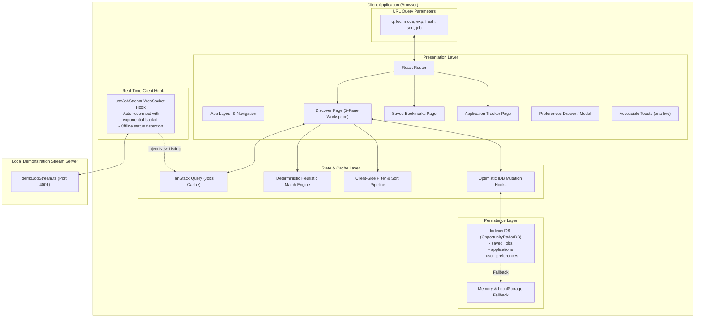

# Opportunity Radar

> **"Find better-fit opportunities before they go stale."**  
> A freshness-first job discovery and application management workspace for students, fresh graduates, and early-career developers in India.

[](https://github.com/example/opportunity-radar)
[](https://www.typescriptlang.org/)
[](https://www.w3.org/WAI/WCAG22/quickref/)
[](LICENSE)

---

## 1. What Problem Does This Solve?

Early-career software developers and fresh engineering graduates in India face three acute pain points on legacy job portals:
1. **The Stale Opportunity Trap:** Listings are frequently weeks or months old, flooded with thousands of applicants where new submissions are never read. Early applications (submitted within 24–48 hours) yield 4× higher callback rates.
2. **Opaque "AI" Scoring:** Portals claim "95% AI Match" without explaining why, misguiding candidates on prerequisites and seniority levels.
3. **Fragmented Tracking:** Bookmarks and applications are scattered across browser tabs and spreadsheets, resulting in missed interviews and lost notes.

**Opportunity Radar** solves these problems through an editorial, high-density career workspace prioritizing newly posted opportunities, deterministic transparent match explanations, and local-first persistence via IndexedDB.

---

## 2. Key Features

- **⚡ Freshness-First Discovery Engine:** Prominently surfaces postings under 24 hours ("Posted Today") and under 72 hours, with chronological and freshness-weighted sorting.
- **🔗 URL-Backed Multi-Faceted Filters:** Filter by Indian tech hubs (Bengaluru, Pune, Hyderabad, Gurugram, Mumbai, Chennai, Remote India), work modes (Remote, Hybrid, On-site), experience level (Internship, Entry-Level, Junior), domain categories, and minimum INR compensation. Every filter permutation is deep-linkable and survives page refresh.
- **🎯 Transparent Heuristic Job-Fit Score:** A 100% deterministic scoring model (+30% required skills, +10% preferred skills, +25% seniority band, +20% work mode, +15% location) detailing matched and missing skills without black-box AI claims.
- **💾 Local-First Persistence (IndexedDB):** Bookmarked jobs, application funnel stages (`Saved` → `Applied` → `Interviewing` → `Offer` / `Not Selected`), and personal interview preparation notes persist across browser sessions with optimistic updates and safe rollbacks.
- **📊 Application Tracker with CSV Export:** Pipeline summary counters, inline status updates, interview date tracking, custom notes editing, and one-click CSV backup download.
- **📡 Real-Time Demonstration Stream (WebSocket):** Companion Node.js service emitting newly posted candidate listings live to connected clients, featuring automatic exponential backoff reconnect and graceful offline mode.
- **♿ Accessibility (WCAG 2.2 AA):** Strict semantic markup, accessible dialog focus traps, polite live regions (`aria-live="polite"`), high-contrast palette (≥ 5.1:1 on all text), and full keyboard navigation.

---

## 3. Technology Stack

| Layer | Technologies Selected | Justification |
| :--- | :--- | :--- |
| **Core Framework** | React 18, TypeScript (Strict) | Component composability, strict compile-time domain models, zero `any` shortcuts |
| **Build & Dev Tool**| Vite 6 | Sub-second Hot Module Replacement (HMR), tree-shaking, optimized production bundling |
| **Routing** | React Router v6 | Deep-linking, URL searchParams synchronization, nested layout routes |
| **Async Cache** | TanStack Query (React Query) | Request lifecycle management, caching, background invalidation on WebSocket events |
| **Styling** | CSS Modules + CSS Custom Properties | Zero runtime CSS overhead, 4px spatial grid, high-contrast semantic tokens |
| **Icons** | Lucide React | Uniform, accessible SVG icons |
| **Storage Engine** | IndexedDB via `idb` | Asynchronous, non-blocking structured storage with memory fallback |
| **Testing** | Vitest, React Testing Library | Fast unit and integration tests mimicking real user behavior |
| **Stream Server** | Node.js + `ws` + `tsx` | Lightweight companion WebSocket stream server |

---

## 4. Architecture Diagram



---

## 5. Prerequisites

- **Node.js:** v18.0.0 or later (Tested on Node.js v24.21.0)
- **npm:** v9.0.0 or later (Tested on npm 11.19.0)

---

## 6. Installation & Startup

### 1. Clone & Install Dependencies
```bash
cd opportunity-radar
npm install
```

### 2. Start the Frontend Application
```bash
npm run dev
```
Open **[http://localhost:5173](http://localhost:5173)** in your browser. The application launches directly into the job discovery workspace.

### 3. (Optional) Start the Real-Time Demonstration WebSocket Server
In a separate terminal window:
```bash
npm run server
```
The server will start on `ws://localhost:4001`. The frontend header indicator will pulse green (`Live Stream Active`) and automatically receive newly streamed demo opportunities.  
*Note: If the server is not running, the application gracefully operates in "Local Mode (Stream Inactive)" without throwing errors.*

---

## 7. Quality & Verification Scripts

Opportunity Radar includes a comprehensive test and validation suite:

```bash
# Run strict TypeScript type checking (0 errors)
npm run typecheck

# Run ESLint static analysis (0 errors, 0 warnings)
npm run lint

# Run all unit and component tests (10 suites, 43 tests)
npm test

# Run tests in watch mode
npm run test:watch

# Format code with Prettier
npm run format

# Build optimized production bundle
npm run build

# Preview production build locally
npm run preview
```

---

## 8. Demonstration Dataset & Product Integrity

> **Notice:** All employer names, company descriptions, and listings within Opportunity Radar are **clearly labelled demonstration records** crafted for portfolio testing and technical interview evaluation.  
> The application does **not** scrape live job boards, require external authentication credentials, or make false claims of live hiring partnerships.

---

## 9. Deployment Guide (Vercel & Netlify)

The application is fully client-side rendered and ready for static hosting:

### Deploying to Vercel
1. Set the root directory to `opportunity-radar`.
2. Framework Preset: **Vite**.
3. Build Command: `npm run build`.
4. Output Directory: `dist`.
5. Rewrites configuration (for client-side routing fallback):
   Create `vercel.json` in the root:
   ```json
   {
     "rewrites": [{ "source": "/(.*)", "destination": "/index.html" }]
   }
   ```

### Deploying to Netlify
1. Publish directory: `dist`.
2. Build command: `npm run build`.
3. Add a `_redirects` file in `public/`:
   ```
   /*    /index.html   200
   ```

*Note: In static deployments on Vercel or Netlify, the optional WebSocket stream server (`npm run server`) is not running. The frontend detects this and runs smoothly in local demonstration mode.*

---

## 10. Project Documentation Index

- [`docs/REFERENCE_AUDIT.md`](docs/REFERENCE_AUDIT.md) — Research audit of real product interfaces (Linear, GitHub, Wellfound, Ashby, Radix UI) and W3C engineering standards.
- [`docs/DESIGN_SYSTEM.md`](docs/DESIGN_SYSTEM.md) — Visual tokens, typography scale, spacing rhythm, semantic colors, and accessibility rules.
- [`docs/ARCHITECTURE.md`](docs/ARCHITECTURE.md) — System architecture, module boundaries, data flow diagrams, and match-fit formulas.
- [`docs/ENGINEERING_DECISIONS.md`](docs/ENGINEERING_DECISIONS.md) — Architecture Decision Records (ADRs) covering state, styling, persistence, and trade-offs.
- [`docs/TEST_PLAN.md`](docs/TEST_PLAN.md) — Comprehensive testing philosophy, coverage matrix, and test scenarios.
- [`docs/QUALITY_REPORT.md`](docs/QUALITY_REPORT.md) — Actual verified execution output for builds, typechecks, lints, and test suites.
- [`docs/INTERVIEW_GUIDE.md`](docs/INTERVIEW_GUIDE.md) — 25 deep technical interview questions and answers for early-career developers.
- [`docs/DATA_MODEL.md`](docs/DATA_MODEL.md) — TypeScript domain types, schemas, and IndexedDB object stores.
