# System Architecture: Opportunity Radar

_Role: Staff UI Architect & Performance Engineer_  
_Date: October 2026_

---

## 1. High-Level Architecture Overview

Opportunity Radar is architected as an **information-dense, local-first web application** built with React, TypeScript, React Router, TanStack Query, and IndexedDB.

```mermaid
flowchart TD
    subgraph Browser ["Client Application (Browser)"]
        subgraph URL ["URL Query Params"]
            QP["q, loc, mode, exp, fresh, sort, job"]
        end

        subgraph Presentation ["Presentation Layer"]
            Router["React Router (v6/v7)"]
            Shell["App Shell & Navigation"]
            Discover["Discover Page (2-Pane Workspace)"]
            Saved["Saved Bookmarks Page"]
            Tracker["Application Tracker Page"]
            PrefModal["Preferences Drawer / Modal"]
            Toast["Accessible Toast Region (aria-live)"]
        end

        subgraph StateManagement ["State & Cache Layer"]
            TQ["TanStack Query (Async Job Fetch & Cache)"]
            FitEngine["Deterministic Heuristic Match Engine"]
            FilterEngine["Client-Side Filter & Sort Pipeline"]
            IDBHooks["Optimistic IDB Mutation Hooks"]
        end

        subgraph LocalStorageEngine ["Persistence Layer"]
            IDB["IndexedDB (OpportunityRadarDB)
- saved_jobs
- applications
- user_preferences"]
            MemFallback["In-Memory & LocalStorage Fallback"]
        end

        subgraph RealTime ["Real-Time Stream Client"]
            WSHook["useJobStream WebSocket Hook
- Auto-reconnect with exponential backoff
- Offline status detection"]
        end
    end

    subgraph ServerStream ["Local Demonstration Stream Server"]
        WSServer["demoJobStream.ts (Node.js ws)
Port: 4001"]
    end

    QP <--> Router
    Router --> Discover & Saved & Tracker
    Discover --> FilterEngine & FitEngine
    Discover <--> IDBHooks
    IDBHooks <--> IDB
    IDB -. Fallback .-> MemFallback
    Discover <--> TQ
    WSHook <--> WSServer
    WSHook -. Inject New Listing .-> TQ
```



---

## 2. Modular Feature Boundaries

The codebase enforces strict separation of concerns across features:

```
src/
├── app/                  # Routing table, QueryClient provider, ErrorBoundary
├── components/
│   ├── ui/               # Reusable primitives: Button, Input, Select, Badge, Card, Modal, Drawer
│   ├── layout/           # AppHeader, PageContainer, SplitPane
│   └── feedback/         # ToastContainer, EmptyState, SkeletonLoader, StatusPill
├── features/
│   ├── jobs/             # JobCard, JobDetailView, JobFitExplainer, jobService
│   ├── search/           # SearchBar, FilterBar, ActiveFilters, useJobFilters
│   ├── saved/            # SavedJobsList, useSavedJobs
│   ├── applications/     # ApplicationTable, StagePicker, StatusBadge, useApplications
│   └── preferences/      # PreferencesForm, usePreferences
├── services/
│   ├── jobService.ts     # Asynchronous job data access boundary
│   └── storage/          # idbStorage.ts (typed IndexedDB wrapper + fallback)
├── types/                # Canonical TypeScript domain interfaces
└── styles/               # tokens.css, global.css, utilities.css
```

---

## 3. Data Flow & URL Synchronization

### 3.1 Bidirectional URL State Pattern

State required to reproduce the search experience is stored in the browser's URL query string rather than private React state:

| Param   | Description                                                                 | Example                |
| :------ | :-------------------------------------------------------------------------- | :--------------------- |
| `q`     | Free-text search across titles, skills, and companies                       | `?q=react+developer`   |
| `loc`   | Location filter token                                                       | `?loc=Bengaluru`       |
| `mode`  | Work arrangement filter (`remote`, `hybrid`, `onsite`, `all`)               | `?mode=remote`         |
| `exp`   | Experience level filter (`internship`, `entry`, `junior`, `mid`, `all`)     | `?exp=entry`           |
| `fresh` | Freshness window (`24h`, `3d`, `7d`, `all`)                                 | `?fresh=24h`           |
| `sort`  | Sort order (`freshness_desc`, `freshness_asc`, `score_desc`, `salary_desc`) | `?sort=freshness_desc` |
| `job`   | Currently inspected job ID in the detail pane                               | `?job=opp-in-001`      |

**Benefits:**

- **Zero-Friction Sharing:** Users can bookmark or email specific search views.
- **Back/Forward Cache Integrity:** Browser navigation preserves exact search, filter, and selected job state.
- **Refresh Resilience:** Reloading does not wipe the candidate's active search.

### 3.2 Debounced Search Execution

To maintain 60 FPS typing responsiveness and avoid micro-stutters during fast input, the text search input maintains immediate local input state while debouncing URL query parameter updates by **250ms**.

---

## 4. Deterministic Heuristic Match-Fit Algorithm

Opportunity Radar rejects opaque "AI-generated" percentages in favor of a **100% deterministic, explainable heuristic scoring model**.

```
Overall Score (0 - 100) =
    Skill Match Component (40 pts max)
  + Seniority / Experience Component (25 pts max)
  + Work Arrangement Component (20 pts max)
  + Location Compatibility Component (15 pts max)
```

### Detailed Component Breakdown:

1. **Skill Match (Max 40 points):**
   - Let $R$ be the set of Required Skills for the job.
   - Let $U$ be the set of User Skills.
   - Overlap Ratio $O = \frac{|R \cap U|}{|R|}$.
   - Required Skill Points = $O \times 30$ points.
   - Preferred Skill Bonus: If job preferred skills intersect user skills, award up to 10 points ($2$ points per matched preferred skill, max 10).
2. **Seniority / Experience Match (Max 25 points):**
   - If `user.targetExperience === job.experienceLevel`: **25 points**.
   - If adjacent level (e.g. `entry` vs `internship` or `entry` vs `junior`): **15 points**.
   - Otherwise: **5 points**.
3. **Work Mode Match (Max 20 points):**
   - If `job.workMode` is present in `user.preferredWorkModes`: **20 points**.
   - If user accepts `hybrid` and role is `remote`: **15 points**.
   - Otherwise: **0 points**.
4. **Location Match (Max 15 points):**
   - If `job.workMode === 'remote'`: **15 points** (universal location eligibility).
   - Else if `job.location` matches any entry in `user.preferredLocations`: **15 points**.
   - Otherwise: **0 points**.

### Transparency Deliverable:

Every calculated score produces a `FitScoreBreakdown` object:

- Exact matched skills list (e.g., `["React", "TypeScript", "CSS"]`)
- Missing prerequisite skills list (e.g., `["Next.js", "Docker"]`)
- Experience level compatibility explanation
- Work mode alignment confirmation

---

## 5. Storage Layer & Optimistic Updates with Rollback

### 5.1 IndexedDB Repository Pattern

Data persistence uses an explicit asynchronous repository interface (`src/services/storage/idbStorage.ts`) wrapping IndexedDB:

```typescript
export interface StorageRepository {
  getSavedJobs(): Promise<SavedJobRecord[]>;
  saveJob(job: JobListing): Promise<void>;
  unsaveJob(jobId: string): Promise<void>;
  isJobSaved(jobId: string): Promise<boolean>;
  getApplications(): Promise<JobApplicationRecord[]>;
  saveApplication(app: JobApplicationRecord): Promise<void>;
  deleteApplication(id: string): Promise<void>;
  getUserPreferences(): Promise<UserPreferences | null>;
  saveUserPreferences(prefs: UserPreferences): Promise<void>;
}
```

### 5.2 Optimistic Updates with Rollback Strategy

When a user toggles a job bookmark or alters an application stage:

1. **Immediate Optimistic UI Update:** React state updates instantaneously; the icon fills or stage badge shifts immediately.
2. **Dispatched Async Persistence:** The mutation is sent to IndexedDB.
3. **Rollback on Rejection:** If the storage operation fails (e.g., IndexedDB storage quota exceeded or transaction abort):
   - State is rolled back to its previous snapshot.
   - An error toast is dispatched to the screen reader and UI (`"Failed to save changes. Reverting."`).

---

## 6. Real-Time Stream Architecture (WebSocket)

### 6.1 Demonstration Stream Mechanics

In `server/demoJobStream.ts`, a standalone Node.js WebSocket server runs on port 4001:

- Upon connection, sends a `CONNECTED` welcome event.
- Periodically emits a `NEW_JOB_OPPORTUNITY` payload containing a fresh, realistic demonstration job posting.
- Emits a `HEARTBEAT` every 30 seconds to verify socket liveness.

### 6.2 Frontend Stream Hook (`useJobStream`)

- Connects to `ws://localhost:4001` (configurable via `VITE_WS_URL`).
- Manages socket lifecycle with state transitions: `connecting` → `connected` → `disconnected`.
- Implements an exponential backoff reconnect policy (1s, 2s, 4s, max 10s, max 5 attempts).
- **Graceful Degradation:** If the server is offline (e.g. standard static production build on Vercel/Netlify), the hook sets status to `offline_mode`. The UI displays a clear "Local Mode (Live Stream Inactive)" badge and runs 100% reliably using seed data.
